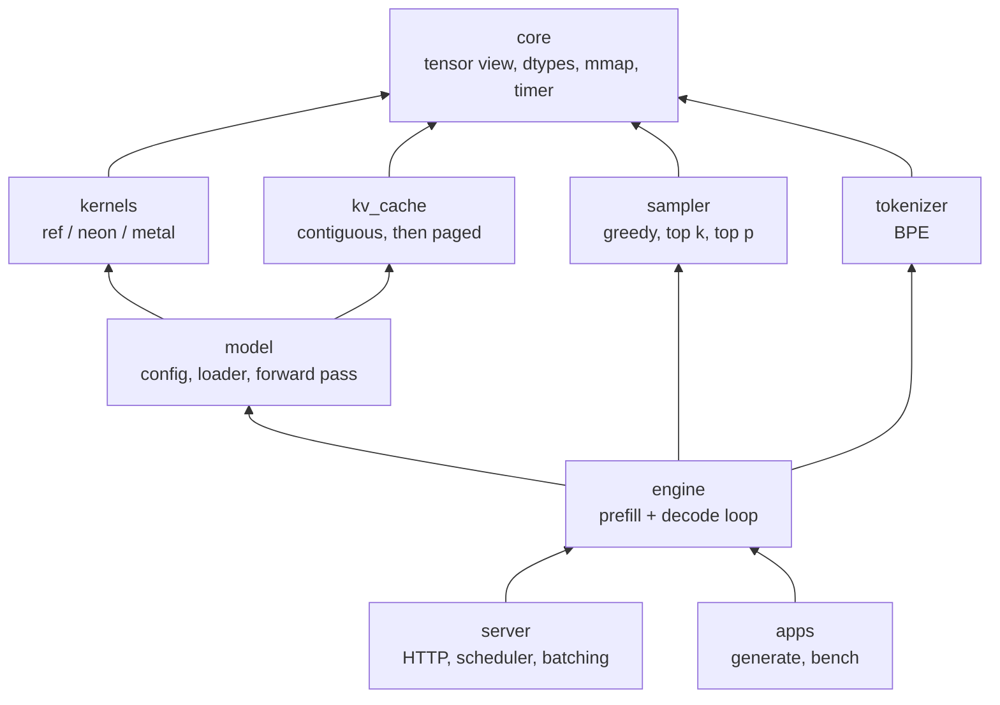

# Architecture

wiLLM is split into small libraries under `src/`, one per concern. Each is
its own CMake target (`willm::core`, `willm::model`, ...) with a public
`include/willm/<module>/` folder and nothing else exported.

## Module dependency graph

An arrow means "links and may include headers from". The spine is
`core ← kernels ← model ← engine ← server`. Tokenizer, sampler and kv_cache
hang off `core` as side branches.

### Why it is shaped this way

* **Dependencies only point down.** A module can be built and tested with only
  what sits below it. You can test a matmul kernel without a model file, and
  test the model without an HTTP server. No cycles also means no "everything
  includes everything" build.
* **Each layer knows one level of abstraction.**
  `kernels` do math on tensor views and know nothing about transformers.
  `model` knows the Llama architecture but not about requests or sampling.
  `engine` knows one sequence's life (prefill, then decode token by token).
  `server` knows many concurrent requests, HTTP and scheduling.
  When you swap a backend (ref to NEON to Metal) only `kernels` changes, and
  when you change batching only `server` and `engine` change.
* **Tokenizer and sampler do not need the model.** The tokenizer maps text to
  integers and the sampler maps a logits array to an integer. Keeping them
  independent makes them trivially unit testable and reusable.
* **kv_cache does not depend on model.** It takes plain sizes
  (`n_layers`, `seq_len`, `kv_dim`), so the paged cache in M6 can be built and
  tested without touching the forward pass. The model receives a cache to
  read from and write to, the engine owns it.
* **The compiler enforces it.** Each module only exposes its own include
  folder, so `#include "willm/server/..."` from `model/` fails to compile
  because `model` does not link `server`. See `cmake/WillmModule.cmake`.

## How a request flows (target design)

This is where the milestones are heading. Today only `core` is real.

1. **server** (M6) receives `POST /v1/completions`, puts the request in a queue,
   and the scheduler adds it to the running batch.
2. **engine** (M1, M2) creates a session for the request: a KV cache slot and a
   sampler seeded from the request.
3. **tokenizer** (M2) encodes the prompt into token ids, with BOS prepended.
4. **Prefill**: **model** runs the forward pass over all prompt tokens. For each
   layer it calls **kernels** (RMSNorm, matmul, RoPE, attention, SwiGLU) and
   writes keys and values into **kv_cache**. Time to first token ends here.
5. **Decode loop**: for each new token, **model** runs one position, reading
   all earlier K and V from the cache and producing logits. **sampler** picks
   the next id, **tokenizer** decodes it to text, and **server** streams it out.
   Stops at EOS, `max_new_tokens` or the context limit.
6. The session ends and its KV cache memory is returned.

## Memory ownership

* Weights live in an `core::MmapFile`. The model holds `ConstTensorView`s that
  point straight into the mapping (zero copies).
* Activations will live in an arena owned by the session (added in M1).
* Kernels never allocate. They receive output views and write into them.

Everything that owns a resource is an RAII type, and there is no global mutable state.
